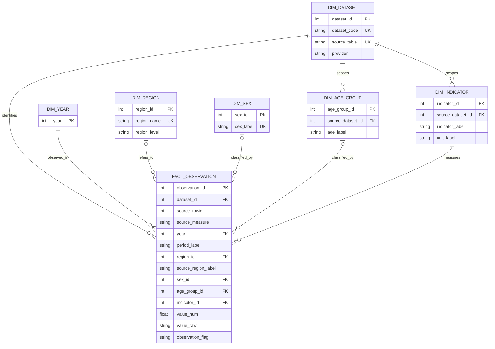

# Estonia Migration — ER model / Entitno-relačný model

## Purpose

A **source-preserving fact constellation**: original 13 statistical tables remain intact and form the immutable ingestion layer. Six shared dimensions and one generic observation fact table form a relational layer. Its `dataset_id` + `source_rowid` + `source_measure` identifies the corresponding cell in an original table. This is a *logical provenance reference*: SQLite cannot declare a conventional FK to one of 13 dynamically selected source tables.

## Entity–relationship diagram

## Data grain and modeling boundaries

One `fact_observation` row represents **one original measurement cell** (identified by dataset, SQLite source rowid and measurement column), *not* necessarily one person, event, or one county-year. All 13 datasets participate. `NH01` has multiple columns `Number ...` and is unpacked into separate observations, preserving provenance in `source_measure`. Other source tables are single-measure facts. Rows with missing official values are retained with `value_num=NULL` and original `value_raw` retained. Values marked `..`, `:` etc are not converted to zero.

`dim_region` is limited to country Estonia and 15 counties with recognizable labels. Special sub-county categories, unknown regions, European aggregates, etc retain `source_region_label` and `region_id=NULL`; never force them into counties. `dim_age_group` and `dim_indicator` are scoped by dataset to avoid false equivalence between source-specific definitions. `dim_sex` preserves source labels; source-specific crosswalks may be added later. Quarterly periods remain in `period_label`, with `year` separately extracted; **do not sum quarterly values without establishing whether the measure is a flow or stock**.

The actual physical design comprises 7 linked new tables plus the preserved source tables, registries, and import logs. A source rowid is stable only if its source table is not rewritten; re-run `populate_model.py --replace` after source ETL replaces tables. This is a general-purpose metadata-linked ER backbone, **not** an assertion that the various sources share exactly comparable measurements.
